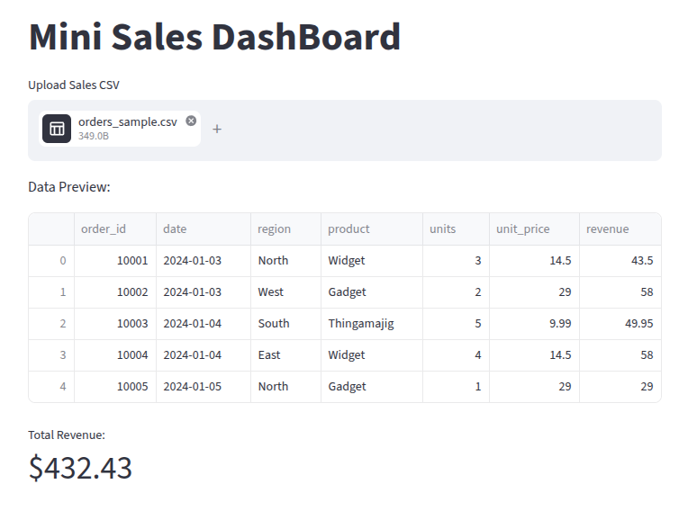
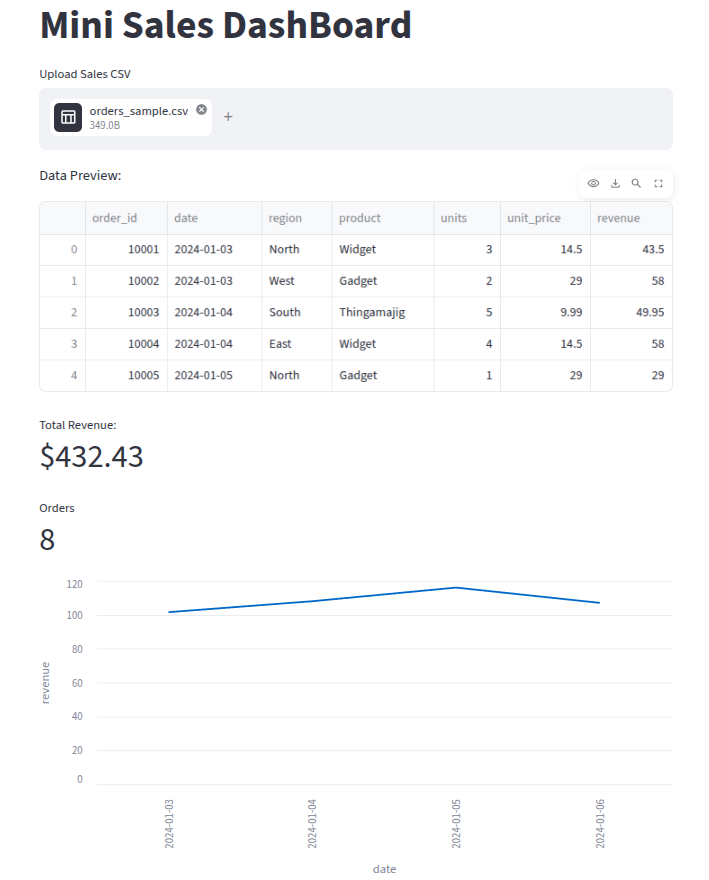
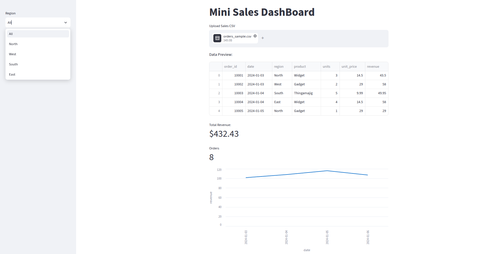

# Streamlit Sales Analysis Mini Project

An interactive sales performance tracking and data visualization dashboard engineered with Python and Streamlit. This application dynamically ingests order transactions to produce meaningful regional and product metrics.

## 🚀 Features
* **Key Metrics Highlights:** Real-time visibility into baseline performance, sales revenue, and business volumes.
* **Interactive Charting:** Dynamic plotting options to toggle between item insights, trend analysis, and performance overviews.
* **Granular Drilldowns:** Segment-focused breakdown exploring performance across target regions (North, East, West, South).

## 📊 Dashboard Previews

### 1. Revenue Overview Dashboard
Overview of the core operational canvas displaying metric blocks alongside baseline data layers.



### 2. Revenue Analytical Charting
A detailed visualization highlighting trends and values parsed across individual products and transaction points.



### 3. Regional Revenue Segmentation
Deep-dive regional analysis evaluating performance differences between active markets.



## 🛠️ Quick Start

### 1. Set Up Environment
```bash
# Initialize local environment
python3 -m venv venv
source venv/bin/activate

# Install core framework
pip install streamlit pandas
```

### 2. Launch the Application
```bash
streamlit run app.py
```

## 📦 Project Directory Layout
```text
.
├── app.py                         # Streamlit application entrypoint
├── orders_sample.csv              # Underlying transaction dataset
├── .gitignore                     # Git tracking safety filter
├── README.md                      # Documentation (You are here)
└── *.png                          # Analytics dashboards asset storage
```
